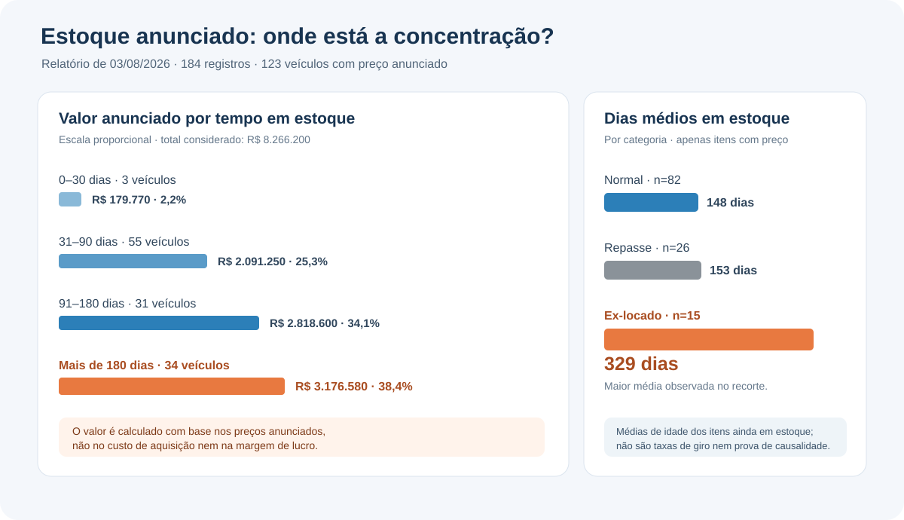

# Análise de estoque de concessionária: valor anunciado e tempo em pátio

Projeto de análise de dados aplicado a um relatório real de estoque de veículos de Lucas do Rio Verde (MT). O objetivo é transformar uma fotografia operacional em indicadores que ajudem a priorizar a investigação comercial do estoque.

> **Pergunta de negócio:** qual é o valor anunciado dos veículos com preço disponível, quanto desse valor está associado a itens há mais de 180 dias no pátio e quais categorias merecem análise adicional?

## Atualização de estoque — 15/10/2026

O projeto passou a comparar duas fotografias: **03/08/2026** e **15/10/2026**. A versão mais recente contém 163 registros, 150 com preço anunciado e 13 sem preço.

| Indicador | 03/08/2026 | 15/10/2026 |
|---|---:|---:|
| Registros de estoque | 184 | 163 |
| Cobertura de preço | 66,85% | 92,02% |
| Soma dos preços anunciados | R$ 8.266.200 | R$ 8.468.420 |
| Registros com preço e mais de 180 dias | 34 | 38 |
| Valor anunciado acima de 180 dias | R$ 3.176.580 | R$ 4.531.630 |
| Parcela do valor anunciado acima de 180 dias | 38,43% | 53,51% |

**Como ler a comparação:** os relatórios têm cobertura de preços diferente, portanto os valores totais e percentuais não são perfeitamente comparáveis. No relatório de outubro, dois registros com preço estão marcados como indisponíveis. Excluindo-os, 36 registros disponíveis com mais de 180 dias somam R$ 4.194.650 — 51,59% do valor anunciado dos registros disponíveis com preço. Preço anunciado não é custo de aquisição nem margem de lucro.

### Arquivos da atualização

- [Base anonimizada de 15/10/2026](estoque_2026-10-15_anonimizado.csv)
- [Histórico agregado dos indicadores](historico_indicadores_estoque.csv)
- [Análise comparativa reproduzível](comparativo_estoque.ipynb)
- [Relatório comparativo em Markdown](comparativo_estoque.md)

O CSV atualizado omite códigos internos, placas, RENAVAM e datas exatas de entrada. As correspondências entre relatórios foram feitas privadamente e são descritas apenas em nível agregado no notebook; nenhum identificador por unidade é publicado.


## Resultados da fotografia de agosto (03/08/2026)

| Indicador | Resultado |
|---|---:|
| Registros de estoque analisados | **184** |
| Registros com preço anunciado | **123** |
| Registros sem preço anunciado | **61** |
| Soma dos preços anunciados | **R$ 8.266.200** |
| Registros com preço e mais de 180 dias em estoque | **34** |
| Valor anunciado desses 34 registros | **R$ 3.176.580 (38,43%)** |

**Importante:** a soma dos preços anunciados é uma aproximação do valor anunciado associado ao estoque. Não é custo de aquisição, capital contábil comprovado, caixa disponível ou margem de lucro. Os resultados de valor consideram apenas os 123 registros com preço informado.



## Principais achados

- **O valor anunciado está concentrado nos carros.** Dos 123 registros com preço, 81 são carros e somam R$ 7.614.020 (cerca de 92% do valor anunciado). As 42 motos com preço somam R$ 652.180 (cerca de 8%).
- **34 registros com preço estão há mais de 180 dias no pátio.** Eles somam R$ 3.176.580 em preços anunciados, ou 38,43% do valor anunciado nos registros com preço.
- **Os ex-locados têm a maior permanência média observada.** A média é de 329 dias, em comparação com 148 dias no grupo normal e 153 dias no grupo de repasse.
- **O grupo de repasse tem média próxima à do grupo normal neste recorte.** Essa semelhança não prova que as categorias tenham a mesma rentabilidade ou velocidade de venda; o conjunto mostra apenas a idade atual dos itens ainda em estoque.

Esses resultados sugerem onde investigar: critérios de precificação, permanência de ex-locados e estratégia de saída de veículos antigos no pátio. Não demonstram, isoladamente, que uma redução de preço aumentaria a rentabilidade ou liberaria caixa em determinada velocidade.

## Metodologia

1. **Preparação dos dados:** informações extraídas de um relatório de estoque em PDF foram estruturadas em um CSV anonimizado. O notebook público começa pelo CSV; o PDF original não faz parte deste repositório.
2. **Validação:** o notebook verifica colunas essenciais, tipos de veículo, preços e dias negativos, e contabiliza linhas integralmente repetidas para diagnóstico.
3. **Análise exploratória:** valor anunciado por tipo e faixa de preço, distribuição por tempo em estoque (*aging*), maiores permanências, comparação entre normal/repasse/ex-locado, preço médio por ano-modelo e distribuição por marca.
4. **Interpretação:** os resultados são lidos como uma fotografia do estoque em **03/08/2026**, não como uma série histórica.

## Ferramentas

- **Python**
- **pandas** e **NumPy** para estruturação e análise
- **Matplotlib** para visualizações
- **Jupyter Notebook** para execução e documentação da análise
- **pdfplumber** foi utilizado na etapa de extração inicial do relatório original; não é necessário para executar a análise pública a partir do CSV anonimizado.

## Como executar

Requisitos: Python e pip instalados.

```bash
git clone https://github.com/thamires-siriustech/estoque-concessionaria-lucas-do-rio-verde.git
cd estoque-concessionaria-lucas-do-rio-verde
pip install -r requirements.txt
jupyter notebook analise_estoque_concessionaria.ipynb
```

Mantenha `analise_estoque_concessionaria.ipynb` e `estoque_lucas.csv` na mesma pasta. No Jupyter, execute **Kernel → Restart & Run All** para recalcular as células e regenerar os gráficos.

## Estrutura do repositório

```
estoque-concessionaria-lucas-do-rio-verde/
├── assets/
│   └── resumo-estoque.svg
├── analise_estoque_concessionaria.ipynb
├── estoque_lucas.csv
├── requirements.txt
└── README.md
```

## Dicionário de dados

| Coluna | Significado |
|---|---|
| `marca` | Marca registrada no relatório |
| `modelo` | Modelo/descrição do veículo |
| `tipo` | Categoria: carro ou moto |
| `m3` | Campo de motorização conforme registrado na fonte |
| `ano` | Campo de ano original do relatório |
| `ano_modelo` | Ano-modelo numérico |
| `cor` | Cor informada |
| `preco` | Preço anunciado; vazio quando não havia preço informado |
| `comb` | Código de combustível conforme registrado na fonte |
| `cambio` | Câmbio informado |
| `locado` | Indicador de veículo classificado como ex-locado |
| `repasse` | Indicador de veículo classificado como repasse |
| `dias` | Dias em estoque na data de referência |
| `loja` | Loja anonimizada (Loja 1, Loja 2 ou Loja 3) |

## Limitações e privacidade

- **Fotografia pontual:** os dados representam o estoque em 03/08/2026. Não permitem calcular taxa de giro histórica nem acompanhar mudanças de preço ou vendas ao longo do tempo.
- **Preço anunciado:** não há custo de aquisição, preço final de venda, despesas, comissões ou margem. Portanto, não é possível calcular lucro ou retorno.
- **Dados ausentes:** 61 registros não têm preço anunciado (51 são motos e 10 são carros) e ficam fora dos cálculos de valor.
- **Sem quilometragem individual:** a comparação por ano-modelo é descritiva, não uma medida de depreciação ajustada por modelo, condição ou quilometragem.
- **Concentração por loja:** a maior parte dos registros está na Loja 1, de modo que comparações entre lojas devem ser interpretadas com cuidado.
- **Registros repetidos:** o CSV mantém linhas integralmente iguais após a anonimização. Elas não são removidas automaticamente, pois podem representar unidades distintas; a exclusão exige validação na fonte.
- **Anonimização:** os nomes das lojas foram substituídos; placas, RENAVAM, códigos internos e datas exatas de entrada não fazem parte do CSV público. A coluna `dias` foi mantida para permitir a análise de permanência.
- **Confidencialidade:** não publique o relatório PDF original nem versões com identificadores ou outros campos que permitam associar registros públicos a unidades da operação. A publicação dos dados deve respeitar a autorização do responsável pela fonte.

## Contexto operacional

Segundo o contexto informado para o projeto, a operação também possui uma locadora e transfere veículos usados na locação para o estoque de revenda. A informação de que veículos saem da locação com aproximadamente 30 mil km é contextual e não consta como quilometragem individual no CSV. Por isso, a análise recomenda investigar a precificação dos ex-locados, mas não presume que esse grupo dê lucro ou prejuízo.

---

**Autora:** Thamires Martins da Silva  
Projeto de portfólio em análise de dados — parte 1 de 2. A segunda parte planejada trata de equipe de vendas e comissionamento.
